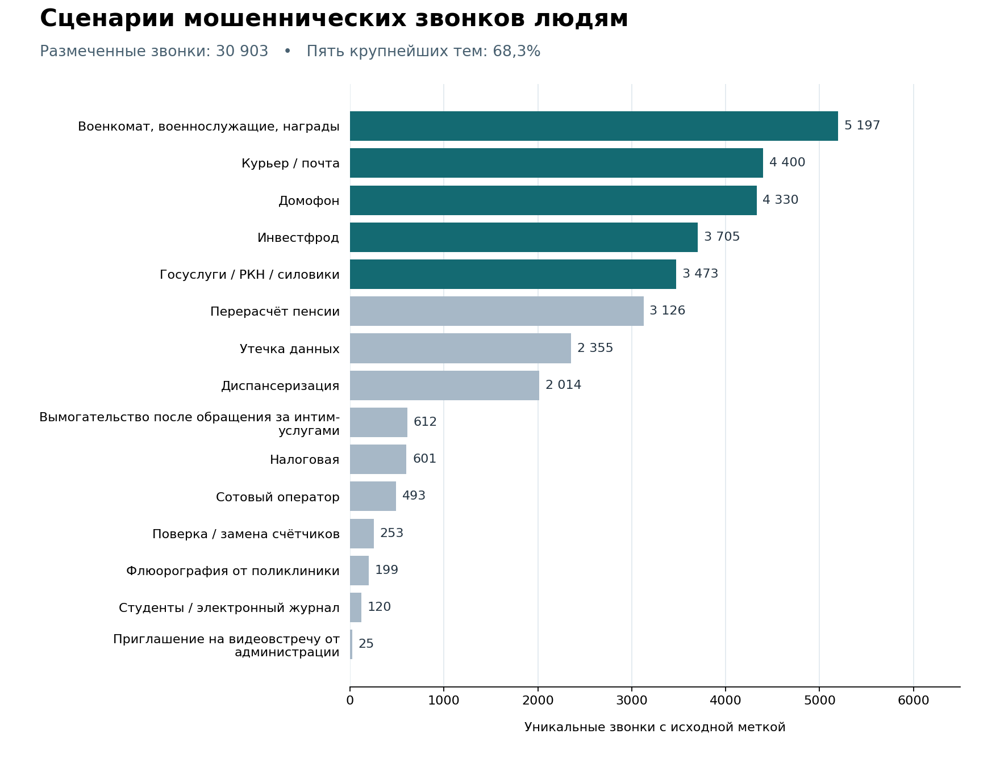

# EDA: входные сценарии голосового агента

Цель анализа — понять, с какими обращениями сталкивается человек в мошеннических звонках, и подобрать входные ситуации для разработки агента. В анализ включены звонки мошенников людям.

## Состав и качество данных

| Проверка | Результат |
| --- | --- |
| Полная выгрузка | 30 904 строки; один повтор строки, 30 903 уникальных ID с исходной темой |
| Пофразовая выгрузка | 707 160 строк для 48 053 уникальных ID |
| Пересечение | Все 30 903 ID полной выгрузки есть в пофразовой |
| Дополнительные ID | 17 150 ID есть только в пофразовой выгрузке; исходная тема не задана |
| Порядок текста | Для 4 992 из 30 903 сопоставленных ID порядок фрагментов в двух представлениях различается; состав слов совпадает |
| Стороны разговора | В трёх вручную проверенных звонках отдельные реплики получателя не обнаружены. Разделение на фрагменты само по себе не определяет говорящего |

Один звонок считается один раз по ID. Распределение тем строится по исходным меткам 30 903 звонков. Звонки без метки учитываются в составе корпуса, но не входят в знаменатель графика. Порядок фрагментов не влияет на подсчёт ID по темам. При выборе вступлений из текста место реплики проверяется отдельно.

## Какие темы покрыть

На военные темы, доставку, домофон, инвестфрод и Госуслуги / РКН / силовиков приходится 21 105 звонков (68,3% размеченной выборки). Это приоритет для наполнения набора разработки. Редкие темы сохраняем в контрольном наборе, даже если их доля в выгрузке мала. Доли характеризуют этот корпус.

Исходные темы достаточно широкие. Например, в доставке встречаются обычное согласование времени доставки и просьба уточнить пункт выдачи под предлогом нечитаемого штрихкода. В налоговой теме встречаются вызов на проверку и сообщение о подозрительном входе в личный кабинет. Эти различия определяют, что агенту нужно понять в первом ответе.

| Ситуация из анализа | Синтетическое вступление для теста | Что проверить |
| --- | --- | --- |
| Доставка, выбор пункта выдачи | «У посылки не читается штрихкод. В какой пункт выдачи её направить?» | Агент понимает, что требуется выбрать пункт, и уточняет варианты. |
| Домофон, выдача ключей | «Домофон уже заменили. Когда вам удобно забрать ключи?» | Агент понимает, что речь о получении ключей, и уточняет время или место. |
| Налоговая, вход в личный кабинет | «Звоним из налоговой. В вашем кабинете заметили вход с другого устройства. Вы заходили?» | Агент реагирует на вопрос о входе и просит уточнить детали; не передаёт данные доступа. |

Реплики в таблице составлены специально для проверки и не являются дословными транскриптами. Остальные примеры находятся в [наборе тестов](../../eval/agent_cases.md). Тематическая группировка помогла найти примеры внутри исходных тем; число кластеров не используется как число типов мошенничества.

Из этих данных можно выбрать входные ситуации. Для измерения продолжительности нужен источник с событиями телефонии, а для разбора реальных ответов человека — проверенная разметка говорящих. В опубликованном отчёте используются только агрегаты и синтетические примеры.

Числа для графика: [scenario_counts.json](scenario_counts.json). График воспроизводится командой `python docs/eda/plot_scenarios.py` из корня репозитория; требуется Matplotlib.
