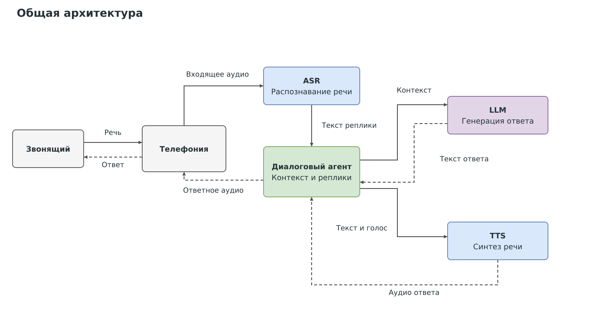
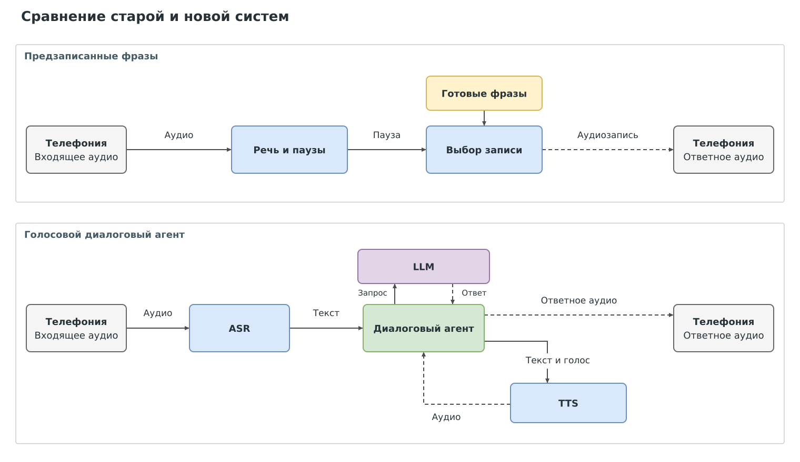
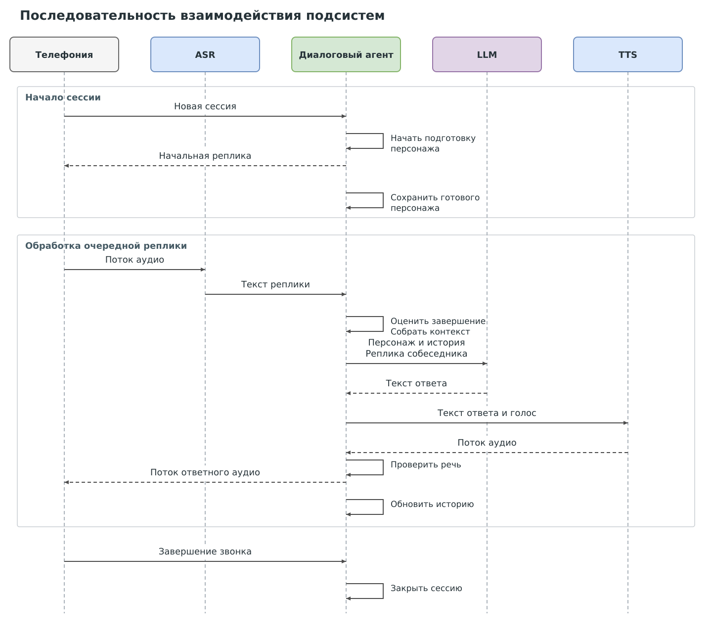

# Киберсемья — дизайн голосового диалогового агента

## 1. Цели и предпосылки

### 1.1. Зачем разрабатывать продукт

**Цель — удерживать телефонного мошенника в разговоре как можно дольше.** Агент общается с ним от лица заданного персонажа, занимая время, которое мошенник мог бы потратить на звонки реальным людям. Продукт предназначен для сервиса защиты абонентов оператора связи.

Базовый подход использует предзаписанные фразы, выбираемые в паузах собеседника. Случайный выбор записи не учитывает смысл обращения и предыдущие реплики. Несоответствие ответа вопросу и повторение готовых фраз могут выдать бота и привести к завершению разговора. Проблема быстрого распознавания обычного голосового бота также описана в [официальной публикации Билайна](https://beelinenow.ru/articles/kiberbabushka-beeline/).

Распознавание речи, языковая модель и синтез позволяют формировать новые ответы с учётом содержания разговора и озвучивать их голосом персонажа. Агент может отвечать на вопросы, продолжать тему и учитывать ранее сообщённые факты.

**Критерий успеха — увеличение средней длительности разговора относительно базового решения.**

### 1.2. Бизнес-требования и ограничения

#### Сценарий использования

Внешняя система направляет подозрительный звонок агенту. При начале сессии запускается подготовка персонажа. Пока персонаж готовится, агент использует заданные начальные реплики. Затем он формирует ответы с учётом персонажа и истории и озвучивает их выбранным голосом до завершения звонка.

#### Требования

| Требование | Обоснование |
| --- | --- |
| Отвечать с учётом текущей реплики и истории | Поддерживать разговор по теме собеседника |
| Сохранять персонажа и согласованность сообщённых фактов | Поддерживать правдоподобие собеседника |
| Синтезировать разборчивую речь с устойчивым голосом | Обеспечивать понятные ответы от лица одного персонажа |
| Учитывать речь, паузы и перебивания при выборе момента ответа | Сохранять естественную очередность реплик |
| Сохранять значимые факты в длинном разговоре | Продолжать диалог при накоплении большой истории |
| Хранить состояние каждой сессии отдельно | Исключать перенос сведений между разговорами |

#### Ограничения

- **Задержка:** ответы должны появляться достаточно быстро для продолжения телефонного разговора.
- **Ресурсы:** распознавание, генерация ответа и синтез должны работать в пределах доступных вычислительных ресурсов при нескольких одновременных сессиях.
- **Контекст:** объём истории ограничен возможностями языковой модели; важные факты необходимо сохранять при сокращении старых реплик.
- **Аудио:** система должна учитывать шум, паузы и одновременную речь, характерные для телефонного разговора.
- **Данные:** записи речи, тексты и код используются в пределах разрешённого доступа и условий конфиденциальности.

### 1.3. Что входит в проект, что не входит

#### Входит

- Голосовой цикл: распознавание речи, генерация ответа и синтез.
- Управление персонажем, состоянием сессии, историей и моментом ответа.
- Адаптация синтеза речи под голос персонажа и разговорные реплики.
- Настройка поведения агента и сохранения фактов в длинных диалогах.
- Проверка уместности ответа, соответствия персонажу и согласованности с историей разговора.
- Проверка качества речи и совместной работы компонентов.

#### Не входит

- Выявление мошеннических звонков и оценка антифрод-классификатора.
- Реализация телефонной маршрутизации и инфраструктуры оператора.
- Обучение модели распознавания речи: используется готовый компонент.

Для воспроизводимости сохраняются конфигурации, версии компонентов и команды запуска.

### 1.4. Предпосылки решения

| Предпосылка | Следствие для решения |
| --- | --- |
| Звонок уже отобран и направлен внешней системой | Агент получает аудиосессию и не определяет, является ли звонящий мошенником |
| Разговор ведётся на русском языке | Распознавание, генерация ответа и синтез должны поддерживать русский язык |
| Аудио поступает потоком; собеседник может делать паузы и перебивать | Требуется управление моментом ответа и воспроизведением аудио |
| Ответ заранее неизвестен | Нужен синтез произвольного текста |
| Персонаж формируется при начале сессии | Пока идёт подготовка, используются заданные начальные реплики; затем описание персонажа включается в контекст |
| История растёт с числом и длиной реплик | Нужны сохранение значимых фактов и ограничение объёма контекста |
| Адаптация голоса требует записей и соответствующих текстов | Речевой корпус служит входом для дообучения синтеза |

## 2. Методология

### 2.1. Постановка задачи

Разработать голосовую диалоговую систему, которая преобразует речь собеседника в текст, формирует ответ от лица персонажа с учётом истории и озвучивает его. Ответы должны поддерживать продолжение разговора.

**Вход:** поток аудио и идентификатор сессии.

**Состояние:** персонаж, выбранный голос, история разговора, значимые факты и текущий этап обработки реплики.

**Выход:** голосовой ответ и обновлённое состояние сессии.

| Компонент | Задача |
| --- | --- |
| Распознавание речи — ASR | Преобразовать реплику собеседника в текст |
| Управление диалогом | Оценить завершённость реплики, выбрать момент ответа, обработать перебивания и согласовать работу компонентов |
| Контекст и память | Передать модели персонажа, последние реплики и сохранённые факты в пределах лимита |
| Языковая модель — LLM | Сформировать ответ по текущей теме от лица персонажа |
| Синтез речи — TTS | Озвучить текст ответа голосом персонажа |

**Синтез речи:** адаптация готовой модели на записях целевого голоса и соответствующих текстах. Задача адаптации — сохранить голос персонажа и обеспечить разборчивость и естественность разговорных реплик.

**Диалоговый агент** — логический блок, объединяющий подготовку персонажа, управление контекстом, обращения к LLM и TTS и управление очередностью реплик. На схемах эти функции представлены совместно.

Агент оценивает завершённость реплики собеседника и выбирает момент ответа. Если собеседник продолжает говорить во время подготовки ответа, начало озвучивания откладывается. При наложении речи агент управляет прерыванием воспроизведения. Новые реплики собеседника и фактически прозвучавшие реплики агента учитываются в следующем контексте.

Постоянные сведения персонажа отделяются от фактов текущего разговора. Для длинных диалогов предусматривается сжатие старой истории с сохранением значимых фактов и последних реплик.

**Оценка поведения:** проверяем уместность ответа, соответствие персонажу и согласованность с историей разговора на заданных тестовых ситуациях.

### 2.2. Схемы решения

#### Общая архитектура

Агент управляет сессией и очередностью реплик, обращается к LLM за текстом ответа, передаёт текст в TTS и возвращает полученное аудио в телефонию.

#### Сравнение базовой и новой систем

Вход и выход в обеих системах относятся к одному модулю телефонии: он передаёт входящее аудио и принимает ответное. В базовом варианте определяется момент воспроизведения готовой записи. В новой системе содержание реплики распознаётся и используется агентом для формирования ответа.

#### Последовательность взаимодействия

Порядок сообщений показан сверху вниз. В начале сессии агент запускает подготовку персонажа и отправляет начальную реплику. После подготовки персонажа ответы формируются с его учётом. Перед началом озвучивания агент проверяет, не продолжил ли собеседник говорить. Последовательность показывает обычный обмен репликами; новые реплики, полученные при перебивании, передаются в следующий контекст.

Сплошные стрелки обозначают входные данные и запросы, пунктирные — возвращаемые результаты и ответы.

[Редактируемые схемы для diagrams.net](diagrams/cyberfamily-diagrams.drawio).

## 3. Этапы решения задачи

### Этап 1. Подготовка данных

Для диалогового компонента используем две имеющиеся выгрузки звонков мошенников людям. Полная выгрузка содержит текст звонка и исходную метку сценария. Пофразовая содержит фрагменты, которые связываются с полным текстом по ID звонка. Анализ выполнен на сохранённых выгрузках. Периодичность их формирования не подтверждена.

В полной выгрузке 30 903 уникальных звонка с меткой, в пофразовой — 48 053 ID. Все размеченные ID находятся в пофразовой выгрузке. Остальные 17 150 ID сохраняем отдельно: исходной метки сценария у них нет. При подсчёте сценариев учитываем каждый ID один раз. У 4 992 сопоставленных звонков представления расходятся по порядку фрагментов. В трёх проверенных человеческих записях не удалось выделить отдельные реплики получателя. Поэтому по этим данным не оцениваем качество ответа человека и не воспроизводим ход разговора без ручной проверки. Подробности и распределение по сценариям приведены в [EDA](eda/README.md).

Для пробной проверки агента данных достаточно. Дополнительный сбор звонков на этом этапе не требуется. По 15 исходным темам подготовлены синтетические входные реплики: 15 для настройки и 15 для контроля. Ещё пять синтетических тестов задают готовую историю разговора и проверяют следующий ответ. Речь звонящего в корпусе используется для выбора ситуаций. Тестовые ответы человека составлены вручную там, где нужно проверить работу с историей. Реплики не используются для обучения классификатора мошеннических сценариев.

Для TTS применяется отдельный речевой корпус: целевая запись и её текст, а при обучении с голосовым референсом — другой фрагмент той же голосовой группы. При подготовке проверяем соответствие текста аудио, шум, обрывы, дубли и допустимость использования голоса. После фильтрации пересобираем пары, чтобы исключённая запись не оставалась референсом. Связанные фрагменты одной исходной записи не разносим между обучением и контролем. Выгрузки звонков не позволяют оценить объём или качество этого аудиокорпуса.

**Конфиденциальность.** Исходные тексты, ID и аудио хранятся в закрытом контуре. В публичной части используем сводные числа и синтетические реплики без персональных сведений.

**Результат этапа:** таблица состава и качества корпуса, [набор тестов для агента](../eval/agent_cases.md), а для синтеза — правила отбора аудио и разделения обучающих и контрольных записей.

### Этап 2. Подготовка моделей

**Диалоговый компонент.** Используем готовую LLM. На вход передаются описание персонажа, доступная история и последняя реплика звонящего. На выходе — короткий текст ответа для синтеза. Текущая конфигурация промпта служит точкой отсчёта. В предложенном варианте добавляем правило явно отвечать на последнюю просьбу и использовать подтверждённые факты из истории. При этом модель, параметры генерации и тестовые входы сохраняем одинаковыми. В рамках такого сравнения веса LLM не обучаются, функция потерь не задаётся.

**Схема проверки.** Промпт меняем на наборе разработки, затем фиксируем и проверяем на контрольных вступлениях и на тестах с историей. Каждый пример запускается с одинаковым заданным состоянием в обоих вариантах. Близкие копии одного скрипта не используем по разные стороны разделения при добавлении новых примеров. Ручная оценка проводится по четырём признакам: уместность, согласованность с персонажем и контекстом, форма телефонной реплики и отсутствие опасных действий. Метрика — доля ответов, прошедших все четыре проверки; отдельно считаем критические ошибки и технические сбои. Это позволяет увидеть, где именно изменение промпта помогает или мешает. Тесты на ответ не измеряют удержание собеседника.

**Синтез речи.** Бейзлайн — исходная модель до адаптации. Сравниваем её с адаптированной на одинаковых отложенных текстах и, где это возможно, одинаковом голосовом референсе. Для обучения в реализации предусмотрены две составляющие: диффузионная потеря генерации целевых аудиопризнаков и кросс-энтропия для предсказания окончания реплики. Потери считаются с маской целевых позиций. Первая составляющая отвечает за формирование речи, вторая — за выбор момента окончания. Коэффициенты относятся к конкретной конфигурации обучения. Для итоговой проверки слушаем пары без указания версии и отмечаем разборчивость, обрывы, естественность и сходство с целевым голосом. Для потокового режима дополнительно измеряем задержку до первого аудио.

**Анализ и развитие.** Ошибки диалога разбираем по тому, какая проверка не прошла: модель не поняла просьбу, забыла факт или ответила не от лица персонажа. Меняем промпт либо состав истории только после разбора конкретного сбоя. Ошибки синтеза разделяем на произношение, неестественные паузы, раннее окончание и нестабильность голоса. По ним решаем, менять ли подготовку текста, данные или настройки обучения. Риски — подгонка под тесты, субъективность прослушивания и разное окружение замеров. Для их снижения фиксируем версии и наборы до прогона, скрываем вариант от проверяющего и удерживаем условия измерения одинаковыми.

**Результат этапа:** фиксированные входы, бейзлайны и [протокол сравнения](../eval/protocol.md). Тесты подготовлены; численные результаты будут внесены после прогонов.

### Этап 3. Интеграция и проверка голосового цикла

Проверяем путь от входящего аудио до звука в телефонии. Отдельные случаи: подготовка персонажа, пауза в середине фразы, продолжение речи до начала ответа, перебивание уже начавшегося ответа и длинная история. Если собеседник продолжил говорить до озвучивания, устаревший ответ не должен прозвучать. При перебивании в контекст передаётся только фактически прозвучавшая часть ответа. Для длинной истории проверяем сохранение последних реплик и актуальных фактов после сокращения контекста. На стенде измеряем время от конца входящей речи до первого звука и фиксируем сбои при одновременных звонках.

На уровне всей системы сравниваем агента с LLM и бейзлайн с предзаписанными репликами. Используем одинаковые условия маршрутизации и определение длительности: от соединения до окончания звонка по событиям телефонии. Основная метрика — средняя длительность; дополнительно показываем медиану, p90 и долю технических сбоев. При наличии сопоставимых замеров звонки людям могут служить дополнительным ориентиром. Для вывода о близости к этому ориентиру заранее фиксируем допустимую разницу. Транскрипты из EDA не содержат замеров длительности.

**Результат этапа:** проверка поведения голосового цикла на заданных сценариях и отчёт о сравнении по событиям телефонии. План сравнения описан в [протоколе](../eval/protocol.md); фактические результаты в текущий отчёт не входят.

## Источники

1. [Шаблон дизайн-документа Reliable ML](https://github.com/IrinaGoloshchapova/ml_system_design_doc_ru/blob/main/ML_System_Design_Doc_Template.md).
2. [Билайн: «Кибербабушка» поможет бороться с мошенниками](https://beelinenow.ru/articles/kiberbabushka-beeline/).
3. [Билайн: описание работы «Киберсемьи»](https://beelinenow.ru/articles/beeline-kibersemya-rezultaty-raboty-letom/).
