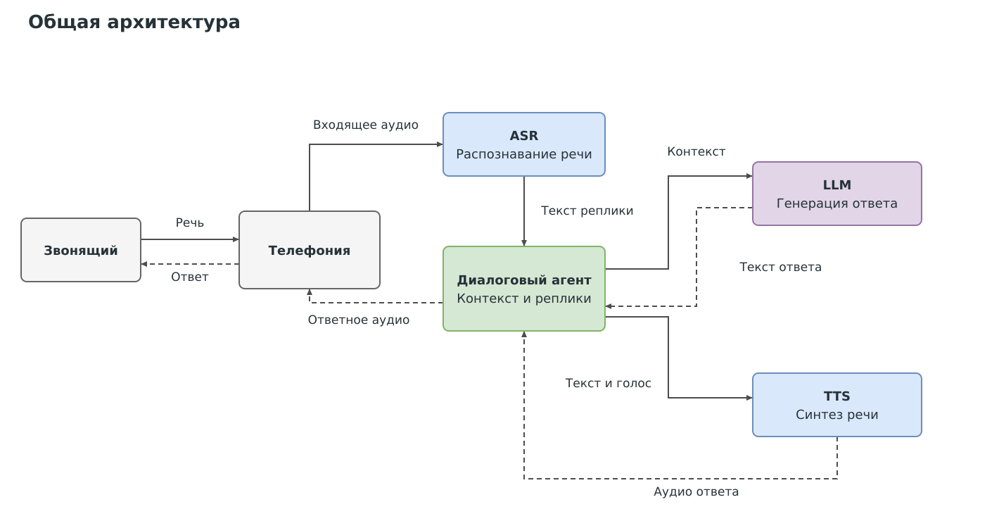
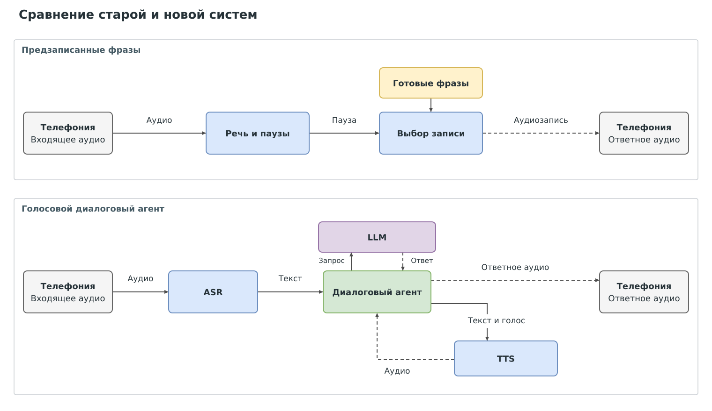
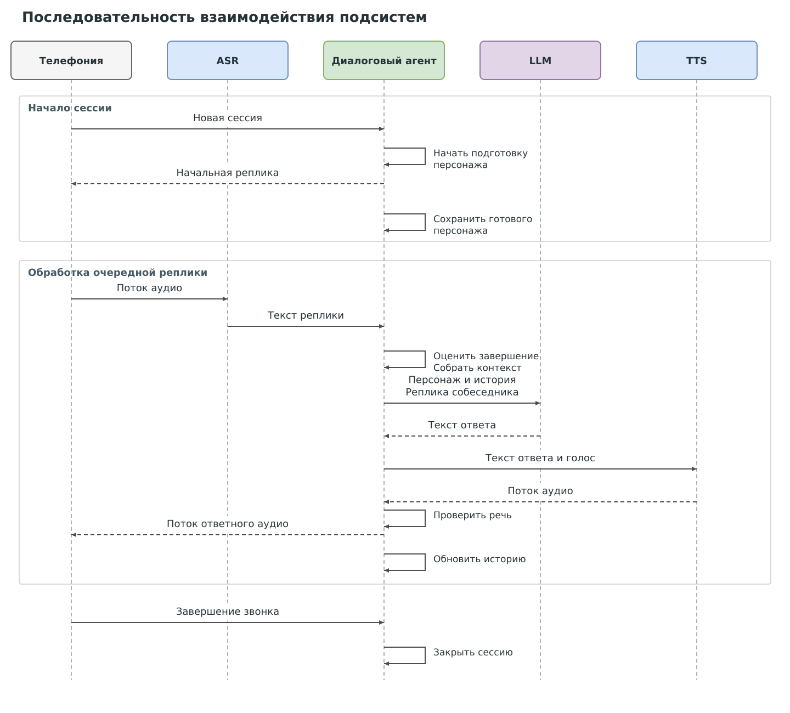

# Киберсемья — дизайн голосового диалогового агента

## 1. Цели и предпосылки

### 1.1. Зачем разрабатывать продукт

**Цель — удерживать телефонного мошенника в разговоре как можно дольше.** Агент общается с ним от лица заданного персонажа, занимая время, которое мошенник мог бы потратить на звонки реальным людям. Продукт предназначен для сервиса защиты абонентов оператора связи.

Базовый подход использует предзаписанные фразы, выбираемые в паузах собеседника. Случайный выбор записи не учитывает смысл обращения и предыдущие реплики. Несоответствие ответа вопросу и повторение готовых фраз могут выдать бота и привести к завершению разговора. Проблема быстрого распознавания обычного голосового бота также описана в [официальной публикации Билайна](https://beelinenow.ru/articles/kiberbabushka-beeline/).

Распознавание речи, языковая модель и синтез позволяют формировать новые ответы с учётом содержания разговора и озвучивать их голосом персонажа. Агент может отвечать на вопросы, продолжать тему и учитывать ранее сообщённые факты.

**Критерий успеха — увеличение средней длительности разговора относительно базового решения.**

### 1.2. Бизнес-требования и ограничения

#### Сценарий использования

Внешняя система направляет подозрительный звонок агенту. При начале сессии запускается подготовка персонажа. Пока персонаж готовится, агент использует заданные начальные реплики. Затем он формирует ответы с учётом персонажа и истории и озвучивает их выбранным голосом до завершения звонка.

#### Требования

| Требование | Обоснование |
| --- | --- |
| Отвечать с учётом текущей реплики и истории | Поддерживать разговор по теме собеседника |
| Сохранять персонажа и согласованность сообщённых фактов | Поддерживать правдоподобие собеседника |
| Синтезировать разборчивую речь с устойчивым голосом | Обеспечивать понятные ответы от лица одного персонажа |
| Учитывать речь, паузы и перебивания при выборе момента ответа | Сохранять естественную очередность реплик |
| Сохранять значимые факты в длинном разговоре | Продолжать диалог при накоплении большой истории |
| Хранить состояние каждой сессии отдельно | Исключать перенос сведений между разговорами |

#### Ограничения

- **Задержка:** ответы должны появляться достаточно быстро для продолжения телефонного разговора.
- **Ресурсы:** распознавание, генерация ответа и синтез должны работать в пределах доступных вычислительных ресурсов при нескольких одновременных сессиях.
- **Контекст:** объём истории ограничен возможностями языковой модели; важные факты необходимо сохранять при сокращении старых реплик.
- **Аудио:** система должна учитывать шум, паузы и одновременную речь, характерные для телефонного разговора.
- **Данные:** записи речи, тексты и код используются в пределах разрешённого доступа и условий конфиденциальности.

### 1.3. Что входит в проект, что не входит

#### Входит

- Голосовой цикл: распознавание речи, генерация ответа и синтез.
- Управление персонажем, состоянием сессии, историей и моментом ответа.
- Адаптация синтеза речи под голос персонажа и разговорные реплики.
- Настройка поведения агента и сохранения фактов в длинных диалогах.
- Оценка соответствия ответов персонажу, уместности и согласованности с помощью языковой модели в роли оценщика.
- Проверка качества речи и совместной работы компонентов.

#### Не входит

- Выявление мошеннических звонков и оценка антифрод-классификатора.
- Реализация телефонной маршрутизации и инфраструктуры оператора.
- Обучение модели распознавания речи: используется готовый компонент.

Для воспроизводимости сохраняются конфигурации, версии компонентов и команды запуска.

### 1.4. Предпосылки решения

| Предпосылка | Следствие для решения |
| --- | --- |
| Звонок уже отобран и направлен внешней системой | Агент получает аудиосессию и не определяет, является ли звонящий мошенником |
| Разговор ведётся на русском языке | Распознавание, генерация ответа и синтез должны поддерживать русский язык |
| Аудио поступает потоком; собеседник может делать паузы и перебивать | Требуется управление моментом ответа и воспроизведением аудио |
| Ответ заранее неизвестен | Нужен синтез произвольного текста |
| Персонаж формируется при начале сессии | Пока идёт подготовка, используются заданные начальные реплики; затем описание персонажа включается в контекст |
| История растёт с числом и длиной реплик | Нужны сохранение значимых фактов и ограничение объёма контекста |
| Адаптация голоса требует записей и соответствующих текстов | Речевой корпус служит входом для дообучения синтеза |

## 2. Методология

### 2.1. Постановка задачи

Разработать голосовую диалоговую систему, которая преобразует речь собеседника в текст, формирует ответ от лица персонажа с учётом истории и озвучивает его. Ответы должны поддерживать продолжение разговора.

**Вход:** поток аудио и идентификатор сессии.

**Состояние:** персонаж, выбранный голос, история разговора, значимые факты и текущий этап обработки реплики.

**Выход:** голосовой ответ и обновлённое состояние сессии.

| Компонент | Задача |
| --- | --- |
| Распознавание речи — ASR | Преобразовать реплику собеседника в текст |
| Управление диалогом | Определить момент ответа и согласовать работу компонентов |
| Контекст и память | Передать модели персонажа, последние реплики и сохранённые факты в пределах лимита |
| Языковая модель — LLM | Сформировать ответ по текущей теме от лица персонажа |
| Синтез речи — TTS | Озвучить текст ответа голосом персонажа |

**Синтез речи:** адаптация готовой модели на записях целевого голоса и соответствующих текстах. Задача адаптации — сохранить голос персонажа и обеспечить разборчивость и естественность разговорных реплик.

**Диалоговый агент:** настройка инструкции персонажа и работы с историей. Постоянные сведения персонажа отделяются от фактов текущего разговора. Для длинных диалогов предусматривается сжатие старой истории с сохранением значимых фактов и последних реплик.

**Оценка поведения:** языковая модель в роли оценщика проверяет уместность ответа, соответствие персонажу и противоречия с историей разговора.

### 2.2. Схемы решения

#### Общая архитектура

Агент управляет сессией, обращается к LLM за текстом ответа, передаёт текст в TTS и возвращает полученное аудио в телефонию.

#### Сравнение базовой и новой систем

Вход и выход в обеих системах относятся к одному модулю телефонии: он передаёт входящее аудио и принимает ответное. В базовом варианте определяется момент воспроизведения готовой записи. В новой системе содержание реплики распознаётся и используется агентом для формирования ответа.

#### Последовательность взаимодействия

Порядок сообщений показан сверху вниз. В начале сессии агент запускает подготовку персонажа и отправляет начальную реплику. После подготовки персонажа ответы формируются с его учётом. На схеме подготовка персонажа представлена как операция агента.

Сплошные стрелки обозначают входные данные и запросы, пунктирные — возвращаемые результаты и ответы.

[Редактируемые схемы для diagrams.net](diagrams/cyberfamily-diagrams.drawio).

## Источники

1. [Шаблон дизайн-документа Reliable ML](https://github.com/IrinaGoloshchapova/ml_system_design_doc_ru/blob/main/ML_System_Design_Doc_Template.md).
2. [Билайн: «Кибербабушка» поможет бороться с мошенниками](https://beelinenow.ru/articles/kiberbabushka-beeline/).
3. [Билайн: описание работы «Киберсемьи»](https://beelinenow.ru/articles/beeline-kibersemya-rezultaty-raboty-letom/).
