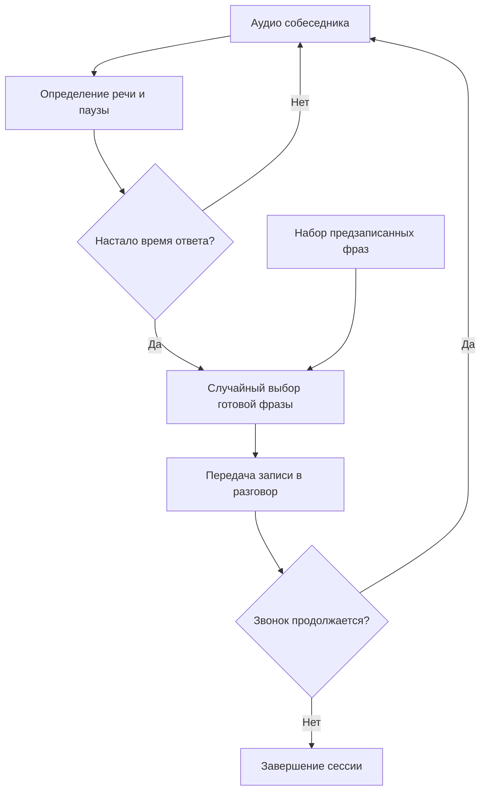
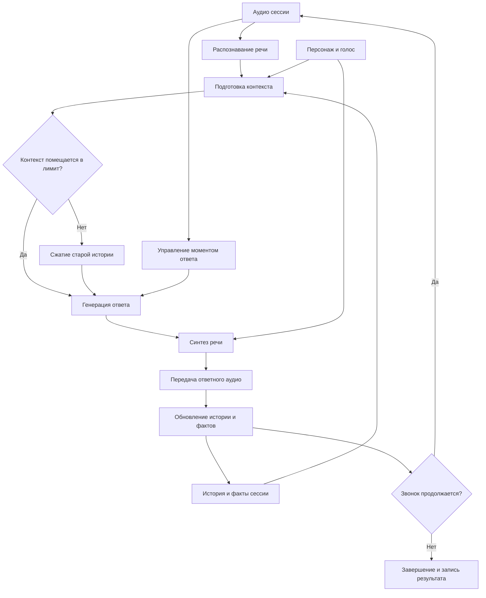
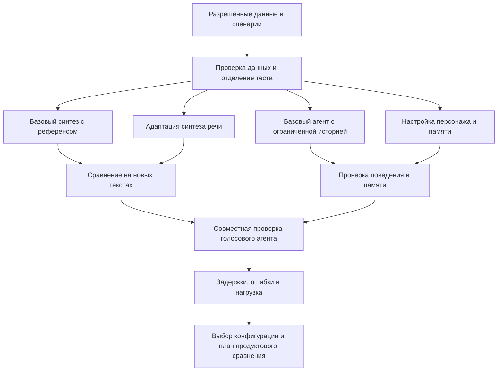

# Киберсемья — дизайн голосового диалогового агента

## 1. Цели и предпосылки

### 1.1. Зачем разрабатывать продукт

**Продуктовая цель — удерживать телефонного мошенника в разговоре как можно дольше.** Пока он общается с агентом, его время занято этим разговором. Заинтересованная сторона — оператор связи, развивающий сервис защиты абонентов от мошеннических звонков.

После передачи вызова агенту система должна поддерживать разговор от лица заданного персонажа: воспринимать речь собеседника, реагировать на её содержание и отвечать голосом. Такое назначение «Киберсемьи» описано в [официальной публикации Билайна](https://beelinenow.ru/articles/beeline-kibersemya-rezultaty-raboty-letom/).

**Ограничение базового подхода.** Система с фиксированным набором предзаписанных фраз может воспроизводить ответы в паузах собеседника, но выбор случайной записи не учитывает смысл его реплики и историю разговора. Возможность продолжить конкретную тему ограничена содержанием записей. В [публичном описании исходной проблемы](https://beelinenow.ru/articles/kiberbabushka-beeline/) Билайн также отмечает, что человек может быстро распознать обычного голосового бота и завершить звонок.

**Почему используется ML.** Распознавание речи позволяет получить содержание обращения. Языковая модель формирует новую реплику с учётом разговора и персонажа. Синтез речи озвучивает произвольный ответ. Это позволяет реагировать на вопросы, возвращаться к ранее обсуждённым фактам и поддерживать разговор за пределами набора готовых записей.

**Что считается успехом.** Основная продуктовая метрика — средняя длительность разговора с агентом. Новое решение должно увеличивать её относительно базового варианта при одинаковых правилах учёта звонков и сопоставимых условиях. Время ожидания без взаимодействия и технические ограничения учитываются отдельно, чтобы увеличение длительности не объяснялось зависанием системы или длинными паузами.

### 1.2. Бизнес-требования и ограничения

#### Сценарий использования

1. Внешняя система выявляет подозрительный вызов и направляет его агенту.
2. Для разговора задаются персонаж и соответствующий голос.
3. Агент принимает аудио, формирует ответ и передаёт его собеседнику.
4. Цикл продолжается до завершения звонка.
5. Для оценки сохраняются версия решения, длительность сессии, причина завершения и технические ошибки.

Выявление мошенничества и решение о перенаправлении звонка относятся к внешней системе. Агент работает с уже переданным ему разговором.

#### Требования

| Требование | Зачем оно нужно | Как проверяется |
| --- | --- | --- |
| Учитывать содержание текущей реплики и историю | Продолжать разговор по теме собеседника | Проверка ответов на одинаковых историях и в многошаговых диалогах |
| Сохранять заданного персонажа и сообщённые им факты | Не разрушать правдоподобие собеседника противоречиями | Проверка биографии, манеры речи и согласованности ответов |
| Выдавать разборчивый голосовой ответ с устойчивым голосом | Собеседник должен понимать реплику и воспринимать её как речь одного персонажа | Проверка текста синтеза и прослушивание одинаковых реплик |
| Выбирать момент ответа с учётом речи собеседника | Избегать постоянного наложения реплик и затяжного молчания | Тесты пауз, окончания реплики и перебиваний |
| Сохранять значимые факты в длинном разговоре при ограниченном контексте | Продолжать диалог после накопления большой истории | Сценарии возврата к старым фактам и измерение размера контекста |
| Изолировать состояние разных сессий | Не переносить сведения одного разговора в другой | Проверка нескольких сессий с различающимися фактами |
| Завершать обработку при окончании звонка и фиксировать сбои | Освобождать ресурсы и объяснять причины завершения | Проверка завершения сессии, ошибок компонентов и освобождения состояния |

#### Ограничения

- **Задержка ответа.** Длинная пауза может помешать продолжению разговора. Измеряется время от окончания речи собеседника до начала передачи ответного аудио. Если измеряется отправка с сервера, показатель не включает неизвестную задержку доставки и воспроизведения в телефонии.
- **Вычислительные ресурсы.** Распознавание, генерация ответа и синтез конкурируют за доступные ресурсы. Производительность проверяется при разных количествах одновременных сессий; бюджет GPU и допустимая нагрузка не подменяются произвольными числами.
- **Ограниченный контекст.** История растёт с числом реплик и их длиной. Управление историей должно учитывать объём текста в токенах, сохраняя важные факты и последние реплики.
- **Телефонное аудио.** Шум, паузы и одновременная речь могут ухудшать распознавание и влиять на момент ответа. Эти условия включаются в проверки голосового взаимодействия.
- **Данные и конфиденциальность.** Публичная реализация и эксперименты используют материалы, разрешённые для такого использования. Корпоративные записи, внутренний код, параметры инфраструктуры и непубличные показатели в документ не включаются. Обезличивание записи само по себе не означает разрешения на её публикацию.

Численные пороги задержки, нагрузки и допустимой доли сбоев пока не заданы. Их необходимо определить по измерениям базового решения и условиям эксплуатации до приёмки системы.

#### Ожидаемый результат первой версии

Работающий голосовой агент, сравнение вариантов синтеза речи и поведения агента, результаты проверки качества и задержек. Для подтверждения продуктового эффекта нужен отдельный способ сравнения длительности на реальных звонках. Воспроизводимый стенд используется для проверки компонентов и совместной работы системы.

Предлагаемый способ продуктовой проверки — назначать сравниваемые версии звонкам по единому правилу и сохранять одинаковый состав показателей. Возможность такого эксперимента и доступ к его результатам пока не подтверждены.

### 1.3. Границы проекта и первой версии

#### Входит в работу

- Голосовой цикл: распознавание речи, генерация ответа и синтез.
- Управление сессией, персонажем, историей и моментом ответа.
- Адаптация TTS под голос персонажа; сравнение с исходной моделью, использующей референс голоса.
- Улучшение поведения агента через настройку инструкции и управления памятью.
- Набор проверочных сценариев и оценка ответов с помощью языковой модели в роли судьи с проверкой части оценок человеком.
- Проверка сквозного взаимодействия компонентов, задержек, ошибок и потребления ресурсов.

#### За границами первой версии

- Выявление мошеннических звонков и оценка качества антифрод-классификатора.
- Реализация телефонной маршрутизации и инфраструктуры оператора связи.
- Обучение ASR с нуля; распознавание используется как готовый компонент.
- Обязательное дообучение LLM или обучение с подкреплением. Необходимость такого улучшения определяется по ошибкам базового агента.
- Подтверждение снижения общего числа атак или предотвращённого денежного ущерба.
- Промышленное масштабирование на весь поток звонков.

#### Результат и воспроизводимость

Для реализованных компонентов сохраняются конфигурации, версии моделей и зависимостей, параметры запуска, процедура подготовки данных и команды оценки. Результаты привязываются к версии решения и фиксированному тестовому набору. Данные настройки и обучения отделяются от финального теста.

Если историческая система и её статистика недоступны, реализуется самостоятельный аналог с предзаписанными фразами. Сравнение с ним описывает результат нового эксперимента и не подтверждает историческое улучшение промышленного продукта.

#### Что остаётся для последующего внедрения

Интеграция с реальной телефонией, требования промышленной эксплуатации, отказоустойчивость при сбоях инфраструктуры и масштабирование уточняются после проверки первой версии. Память между разными звонками одного собеседника рассматривается отдельно от памяти внутри текущей сессии.

### 1.4. Предпосылки решения

| Предпосылка | Следствие для проектирования |
| --- | --- |
| Звонок уже направлен агенту внешней системой | Входом служит аудиосессия; определение мошенничества не включается в диалоговую модель |
| Первичная постановка относится к русскоязычному разговору | Речевые компоненты и тестовые реплики должны поддерживать русский язык |
| Аудио поступает последовательно, а собеседник может делать паузы и перебивать | Требуется управление моментом ответа и воспроизведением, а не только обработка готового файла |
| Текст ответа заранее неизвестен | Нужен синтез произвольных реплик; фиксированный набор записей используется как контрольный вариант |
| Персонаж и история влияют на правдоподобие ответа | Описание персонажа, последние реплики и сохранённые факты включаются в контекст агента |
| История может превысить допустимый контекст модели | Нужна стратегия ограничения или сжатия истории; постоянные факты персонажа хранятся отдельно от изменяемого состояния |
| Для обучения голоса требуется разрешённый речевой корпус | До адаптации нужно определить источник, права использования и разделение записей на обучение и проверку |
| Исторические показатели базового решения недоступны для воспроизводимой проверки | Продуктовое сравнение требует новых измерений либо согласованных исторических данных |

Доступность подходящего корпуса, вычислительного стенда и результатов реальных звонков проверяется до соответствующих экспериментов. Эти ресурсы не считаются уже предоставленными.

## 2. Методология

### 2.1. Техническая постановка задачи

Задача системы — последовательно выбирать и озвучивать реплики, которые поддерживают разговор с собеседником. Это интерактивная задача: каждый ответ влияет на последующие реплики и на решение собеседника продолжать звонок.

**Вход:** поток аудио, идентификатор сессии и заданный персонаж.

**Состояние:** история текущего разговора, значимые факты и сведения о том, слушает ли агент собеседника, формирует ответ или воспроизводит аудио.

**Выход:** голосовая реплика, обновлённое состояние сессии и события для измерения качества работы.

#### Компоненты

| Компонент | Задача | Результат |
| --- | --- | --- |
| Распознавание речи — ASR | Получить содержание реплики из аудио | Текст собеседника |
| Управление диалогом | Определить момент ответа и связать этапы обработки с текущей сессией | Решение о начале ответа и обработка событий сессии |
| Контекст и память | Сохранить персонажа, последние реплики и значимые факты в пределах лимита | Контекст для языковой модели |
| Языковая модель — LLM | Сформировать уместный ответ от лица персонажа | Текст реплики агента |
| Синтез речи — TTS | Озвучить ответ голосом персонажа | Аудио для передачи собеседнику |
| Сбор событий | Зафиксировать длительность, задержки и ошибки | Данные для сравнения версий |

#### Обучаемая часть: синтез речи

Для адаптации используются пары «аудиозапись голоса — соответствующий текст». Проверяются корректность расшифровки, качество записи и пригодность для разговорных реплик. Обучение и оценка выполняются на разных записях; тест включает новые тексты.

Сравниваются исходная модель с референсом голоса и адаптированная модель. Такое сравнение позволяет проверить, даёт ли обучение преимущество перед доступным режимом клонирования голоса без адаптации. Оцениваются ошибки произношения, пропуски и повторы, сходство голоса, естественность и задержка появления аудио.

#### Улучшаемая часть: диалоговый агент

Контрольная конфигурация использует заданного персонажа и недавнюю историю с удалением старых реплик при достижении лимита. Основная конфигурация добавляет явное хранение фактов и сжатие старой истории с сохранением последних точных реплик.

В тестах проверяются ответы на текущую тему, устойчивость персонажа и возвращение к ранее сообщённым фактам. Для длинных разговоров измеряются качество ответов, объём контекста и задержки. Варианты проверяются как на одинаковых историях, так и в самостоятельных многошаговых диалогах.

Языковая модель в роли судьи оценивает ответы по заданным критериям и указывает фрагменты, обосновывающие замечание. Названия сравниваемых вариантов скрываются, порядок ответов меняется, часть оценок проверяется человеком. Эта оценка помогает анализировать ошибки агента и не заменяет измерение длительности реального разговора.

#### Базовые варианты сравнения

| Уровень | Базовый вариант | Проверяемое изменение |
| --- | --- | --- |
| Продукт в целом | Предзаписанные фразы, выбираемые в паузах собеседника | Ответы, сформированные с учётом содержания и истории |
| Синтез | Исходная модель с референсом целевого голоса | Адаптация на речевом корпусе |
| Поведение агента | Инструкция персонажа и ограниченная недавняя история | Улучшенная инструкция, явные факты и сжатие истории |

Для отделения эффектов инструкция и память изменяются по отдельности. При сравнении компонентов остальные части системы и условия запуска фиксируются.

### 2.2. Блок-схемы решения

#### Базовое решение с предзаписанными фразами

В этом варианте аудио влияет на момент воспроизведения, но смысл обращения не определяет содержание ответа.

#### Проектируемый голосовой агент

Схема показывает зависимости компонентов, а не обязательную последовательность всех операций. Распознавание и определение момента ответа могут работать параллельно. В истории необходимо учитывать фактически переданную реплику, включая случаи прерывания воспроизведения.

#### Подготовка и проверка первой версии

### 2.3. Методика измерения и ограничения выводов

**Длительность.** Для каждого звонка сохраняется время от передачи вызова агенту до завершения соединения. Правила начала и окончания измерения одинаковы для всех вариантов. Вместе со средним показываются медиана, распределение длительности, число обменов репликами и причины завершения. Технические сбои и принудительные ограничения помечаются отдельно и входят в отчёт о работе системы.

**Качество синтеза.** Одинаковые новые тексты озвучиваются сравниваемыми вариантами. Автоматическая проверка разборчивости дополняется прослушиванием: ошибки распознавания синтезированного аудио не всегда означают ошибку самого синтеза.

**Качество агента.** Сценарии содержат описание персонажа, факты разговора и критерии проверки. Набор финального теста отделяется от сценариев настройки. Для оценки памяти используются случаи с заранее известными фактами и возвратом к ним через несколько реплик.

**Задержки.** Измеряется сквозное время до ответного аудио и длительность отдельных этапов. Медиана характеризует типичный ответ; p95 — задержку, ниже которой находятся 95% измерений. Отдельно проверяются короткие и длинные истории и несколько одновременных сессий.

**Границы проверки.** Постановочные разговоры и модель-собеседник позволяют проверять устойчивость и сравнивать конфигурации. Их длительность не считается доказательством удержания настоящих мошенников. Для продуктового вывода необходимы реальные звонки и сопоставимая контрольная группа либо иной обоснованный способ сравнения.

## 3. Что требуется уточнить до экспериментов

| Вопрос | Почему влияет на решение |
| --- | --- |
| Какие записи и тексты доступны для адаптации TTS и независимой оценки | Определяет возможность обучения и достоверность проверки голоса |
| Какие данные реальных звонков можно использовать для сравнения версий | Определяет, можно ли подтвердить продуктовый эффект |
| Какой стенд доступен и каковы требования к задержке и нагрузке | Определяет выбор моделей, настройки запуска и критерии приёмки |

Эти сведения уточняются до обучения и выбора итоговой конфигурации.

## Источники

1. [Шаблон дизайн-документа Reliable ML](https://github.com/IrinaGoloshchapova/ml_system_design_doc_ru/blob/main/ML_System_Design_Doc_Template.md) — структура разделов и требование показать базовое и основное решения.
2. [Билайн: «Кибербабушка» поможет бороться с мошенниками, 13 ноября 2025](https://beelinenow.ru/articles/kiberbabushka-beeline/) — назначение продукта, ограничение обычного голосового бота и общая схема формирования ответа.
3. [Билайн: результаты работы «Киберсемьи», 14 августа 2026](https://beelinenow.ru/articles/beeline-kibersemya-rezultaty-raboty-letom/) — публичное описание персонажей, голосов и продолжения разговоров.
